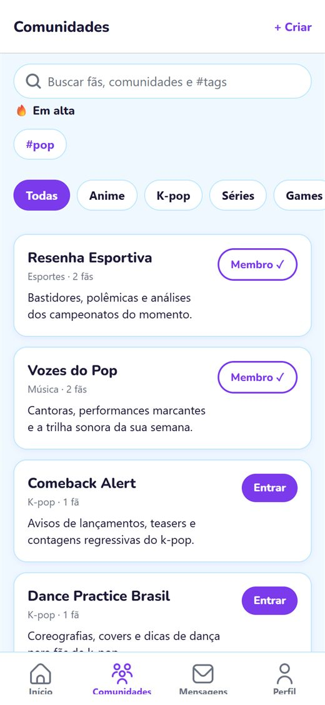
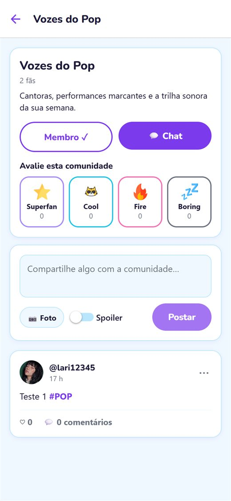
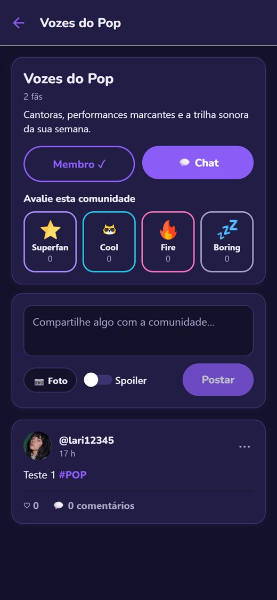

# Stans 💜

**A rede social dos fandoms.** Um "Orkut moderno" para quem é fã de anime, k-pop, séries, games, música, esportes, times e jogadores. Quem usa o Stans é chamado de **fã**.

App mobile (iOS, Android e navegador) feito com **React Native + Expo**, com API em **Node.js + Express + Socket.IO** e banco **PostgreSQL**.

<p align="center">
  
  
  
  
</p>
<p align="center">
  <br>
  <sub>Modo escuro</sub>
</p>

---

## Funcionalidades

### Fãs e perfis
- Cadastro com data de nascimento (idade mínima de **13 anos**), login e recuperação de senha
- Perfil com foto, capa, bio e **status** com emoji e prazo para expirar
- **Avaliações** Superfan, Cool, Fire e Boring: voto anônimo, 1 por semana por perfil, com opção de ocultar os totais
- **Mural de recados** (só os outros escrevem), aberto a todos ou só a quem você segue
- Seguir, seguidores e seguindo
- Modo invisível no chat

### Comunidades e posts
- Comunidades por categoria, com busca e criação
- Avaliação de comunidades (1 voto por semana)
- Feed com as comunidades que você segue, com paginação por cursor
- Posts com foto, aviso de **spoiler**, curtidas e comentários
- **#Hashtags** clicáveis, página por tag e **🔥 Em alta** (as mais usadas da semana)

### Tempo real
- **Chat** privado e de comunidade com Socket.IO: "digitando…", não lidas e limite de envio
- **Notificações** de curtida, comentário, recado, novo seguidor e avaliação

### Segurança
- Mensagem privada **só entre quem se segue mutuamente**
- Proteções para menores de 18 anos: mural restrito por padrão e não aparecem para adultos na busca
- **Filtro de palavrões** (ignora acentos e leetspeak, como `p0rr4`)
- Bloquear e denunciar fãs, posts, comentários e recados
- **Painel de moderação**: ignorar, apagar conteúdo, banir e desbanir
- Senhas com bcrypt, tokens JWT, limite de tentativas no login e uploads checados pelo conteúdo do arquivo (não só pela extensão)

### Visual
- Degradê lilás → ciano, cards arredondados e fonte Nunito
- **Modo escuro** (automático, claro ou escuro)

---

## Tecnologias

| Parte | Tecnologias |
|---|---|
| App | TypeScript, React Native 0.88, Expo SDK 58, Expo Router, react-native-web, Socket.IO client |
| API | TypeScript, Node.js, Express 5, Socket.IO, Zod, JWT, bcrypt, Multer |
| Banco | PostgreSQL (Neon na nuvem ou Docker local), migrações em SQL |
| Hospedagem | Render (API), Netlify (app web), Supabase Storage (fotos) |
| Testes | `node:test` com tsx |

---

## Estrutura

```
stans/
├── mobile-app/            App Expo
│   └── src/
│       ├── app/           Telas (Expo Router: cada arquivo é uma rota)
│       ├── components/    PostCard, ProfileView, RatingButtons, Sheet...
│       ├── api.ts         Cliente da API e mensagens de erro
│       ├── auth.tsx       Sessão (SecureStore no celular, localStorage no navegador)
│       ├── realtime.tsx   Conexão Socket.IO única para o app todo
│       └── theme.ts       Cores, modo escuro e fontes
├── server/                API
│   └── src/
│       ├── routes.ts      Auth, perfis, comunidades, posts, chat
│       ├── social.ts      Busca, notificações, bloqueios, denúncias, senha
│       ├── safety.ts      Idade, filtro de palavrões, regras de mensagem, moderação
│       ├── socket.ts      Chat em tempo real
│       ├── uploads.ts     Fotos de perfil, capa e posts
│       ├── storage.ts     Onde as fotos ficam: disco ou Supabase Storage
│       └── db/            schema.sql e migrations/
└── docker-compose.yml     Postgres local
```

---

## Como rodar

Você precisa do **Node.js 20+** e de um **PostgreSQL** (local com Docker ou na nuvem, como o Neon).

### 1. Banco e API

```bash
docker compose up -d          # Postgres local (pule se usar um banco na nuvem)
cd server
cp .env.example .env          # ajuste DATABASE_URL e troque o JWT_SECRET
npm install
npm run migrate               # aplica as migrações
npm run dev                   # API em http://localhost:4000
```

### 2. App

```bash
cd mobile-app
npm install --legacy-peer-deps
npx expo start --web          # abre em http://localhost:8081
```

No celular, instale o **Expo Go** e leia o QR code (celular e computador na mesma rede Wi-Fi). O app encontra a API sozinho pelo IP do computador; se precisar, defina `EXPO_PUBLIC_API_URL` em `mobile-app/.env.local`.

### Colocar no ar

Dá para publicar de graça com Neon (banco), Supabase Storage (fotos), Render (API) e Netlify (app web). O passo a passo está em **[DEPLOY.md](DEPLOY.md)**.

### Testes

```bash
cd server
npm test
```

---

## Próximos passos
- Recuperação de senha por e-mail (hoje o link aparece no terminal do servidor)
- Notificações push no celular
- Encerrar outras sessões ao trocar a senha

---

## Créditos
Ícones do [Flaticon](https://www.flaticon.com).

Feito por **[Larissa de Farias Santos](https://larissa-de-farias-santos.netlify.app/)**.
